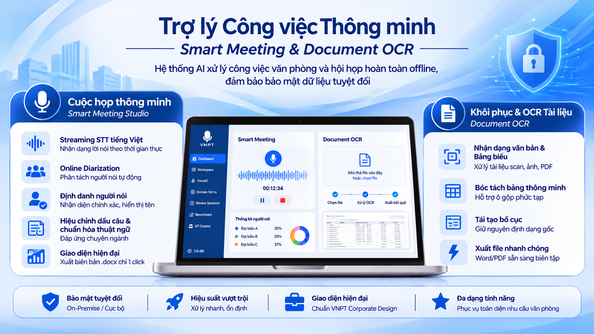

# 🎙️ Trợ lý Công việc Thông minh — Smart Meeting & Document OCR

Hệ thống AI xử lý công việc văn phòng và hội họp **hoàn toàn offline** (On-Premise / Cục bộ), đảm bảo bảo mật dữ liệu tuyệt đối. Tích hợp 2 giải pháp công nghệ cốt lõi trong một nền tảng giao diện thống nhất theo chuẩn **VNPT Corporate Design System**:

1. **Cuộc họp thông minh (Smart Meeting Studio):** Thu âm trực tiếp hoặc phát lại file âm thanh, nhận dạng tiếng Việt thời gian thực (Streaming STT), phân tách người nói tự động (Online Diarization), định danh giọng nói đại biểu (VoiceID 192-dim) và xuất biên bản cuộc họp `.docx` chuẩn mẫu.
2. **Khôi phục & OCR Tài liệu (Document OCR):** Nhận dạng văn bản từ file scan/ảnh/PDF, bóc tách cấu trúc bảng biểu dạng HTML lưới, tái tạo bố cục nguyên bản (Layout Reconstruction) và xuất ra file Word/PDF sẵn sàng biên tập.

<p align="center">
  
</p>

---

## 📑 Mục lục

- [Tổng quan Tính năng](#-tổng-quan-tính-năng)
- [Kiến trúc Hệ thống](#-kiến-trúc-hệ-thống)
- [Cấu trúc Thư mục](#-cấu-trúc-thư-mục)
- [Yêu cầu Hệ thống](#-yêu-cầu-hệ-thống)
- [Hướng dẫn Cài đặt & Cấu hình](#-hướng-dẫn-cài-đặt--cấu-hình)
  - [Bước 1: Cài đặt FFmpeg](#bước-1-cài-đặt-ffmpeg)
  - [Bước 2: Chuẩn bị môi trường Python](#bước-2-chuẩn-bị-môi-trường-python)
  - [Bước 3: Cài đặt các gói phụ thuộc](#bước-3-cài-đặt-các-gói-phụ-thuộc)
  - [Bước 4: Cấu hình tệp `.env`](#bước-4-cấu-hình-tệp-env)
  - [Bước 5: Chuẩn bị Model AI](#bước-5-chuẩn-bị-model-ai)
- [Khởi chạy Ứng dụng](#-khởi-chạy-ứng-dụng)
- [Hướng dẫn Sử dụng các Phân hệ](#-hướng-dẫn-sử-dụng-các-phân-hệ)
  - [1. Dashboard — Trạm kiểm soát trung tâm](#1-dashboard--trạm-kiểm-soát-trung-tâm)
  - [2. Workspace — Studio Cuộc họp & OCR Tài liệu](#2-workspace--studio-cuộc-họp--ocr-tài-liệu)
  - [3. VoiceID — Quản lý CSDL Nhận diện Giọng nói](#3-voiceid--quản-lý-csdl-nhận-diện-giọng-nói)
  - [4. Domain Terms — Từ điển Thuật ngữ Chuyên ngành](#4-domain-terms--từ-điển-thuật-ngữ-chuyên-ngành)
  - [5. Review Sessions — Xem lại & Hiệu chỉnh Dữ liệu](#5-review-sessions--xem-lại--hiệu-chỉnh-dữ-liệu)
  - [6. Benchmark — Đánh giá Đo lường Chất lượng](#6-benchmark--đánh-giá-đo-lường-chất-lượng)
  - [7. GT Creator — Công cụ Gán nhãn Chuẩn](#7-gt-creator--công-cụ-gán-nhãn-chuẩn)
- [Xử lý Sự cố Thường gặp (FAQ)](#-xử-lý-sự-cố-thường-gặp-faq)

---

## 🚀 Tổng quan Tính năng

### 🎙️ Phân hệ Smart Meeting
* **Streaming STT tiếng Việt (Zipformer 16kHz / sherpa-onnx):** Nhận dạng lời nói theo luồng với độ trễ cực thấp, hoạt động ổn định trên CPU máy tính văn phòng thông thường.
* **Online Diarization (Diart + pyannote 3.0):** Tự động phát hiện điểm đổi lượt nói và phân tách các người nói khác nhau ngay khi đang thu âm mà không cần đợi kết thúc cuộc họp.
* **Định danh người nói (Cam++ VoiceID Embedding):** Trích xuất vector đặc trưng 192 chiều từ giọng nói, đối soát cosine similarity với cơ sở dữ liệu đã nạp sẵn vào RAM để hiển thị đích danh tên người phát biểu (VD: *Đ/c Nguyễn Văn A* thay vì *SPEAKER_00*).
* **Hiệu chỉnh dấu câu & chuẩn hóa từ điển (Domain Lexicon):** Tự động sửa lỗi phát âm và viết hoa các thuật ngữ chuyên ngành (Y tế, Pháp luật, Viễn thông...).
* **Giao diện Cockpit Studio hiện đại:** Thanh đo tín hiệu âm thanh (VU Meter) động, bộ đếm thời lượng, thống kê số lượt nói theo thời gian thực và xuất file biên bản `.docx` chỉ với 1 click.

### 📄 Phân hệ Document OCR & Layout Reconstruction
* **Nhận dạng chữ & Bảng biểu (DeepseekOCR Engine):** Xử lý tài liệu scan, ảnh chụp văn bản công văn, hóa đơn, tài liệu hành chính phức tạp.
* **Bóc tách bảng biểu thông minh:** Nhận dạng cấu trúc ô, hỗ trợ các bảng phức tạp có ô gộp hàng/cột (`rowspan`/`colspan`).
* **Căn chỉnh & Tái tạo bố cục (Layout Reconstruction):** Tự động dựng lại file PDF/Word có định dạng, vị trí khối văn bản và bảng biểu trùng khớp với văn bản scan gốc.
* **Quy trình 3 bước trực quan:** `Chọn file` ➔ `Xử lý OCR & Bố cục` ➔ `Xuất file kết quả`.

---

## 🏗️ Kiến trúc Hệ thống

```
                               ┌─────────────────────────────────────────┐
                               │           Streamlit Web UI              │
                               │   (VNPT Blue Corporate Theme: ui/)      │
                               └────────────────────┬────────────────────┘
                                                    │
                      ┌─────────────────────────────┴─────────────────────────────┐
                      ▼                                                           ▼
       【 Phân hệ Smart Meeting 】                                 【 Phân hệ Document OCR 】
   ┌───────────────────────────────────┐                       ┌───────────────────────────────────┐
   │ Mic / File WAV 16kHz Mono Stream  │                       │ File Scan / Ảnh / PDF Đầu vào     │
   └─────────────────┬─────────────────┘                       └─────────────────┬─────────────────┘
                     │                                                           │
        ┌────────────┴────────────┐                                              ▼
        ▼                         ▼                               ┌─────────────────────────────┐
 ┌──────────────┐          ┌──────────────┐                       │   Tiền xử lý & Cắt trang    │
 │ Zipformer STT│          │Diart Diarizer│                       └──────────────┬──────────────┘
 │(sherpa-onnx) │          │(pyannote 3.0)│                                      │
 └──────┬───────┘          └──────┬───────┘                                      ▼
        │ (Văn bản thô)           │ (Phân đoạn speaker)           ┌─────────────────────────────┐
        │                         │                               │   DeepseekOCR Engine &      │
        └────────────┬────────────┘                               │   Nhận diện Bảng (HTML)     │
                     ▼                                            └──────────────┬──────────────┘
   ┌───────────────────────────────────┐                                         │
   │  Cam++ VoiceID Matcher (192-dim)  │                                         ▼
   │  Đối soát Vector CSDL đã nạp RAM  │                          ┌─────────────────────────────┐
   └─────────────────┬─────────────────┘                          │    Layout Reconstruction    │
                     ▼                                            │  (Tái tạo cấu trúc & khung) │
   ┌───────────────────────────────────┐                          └──────────────┬──────────────┘
   │    Chuẩn hóa Thuật ngữ Chuyên môn │                                         │
   │       (core/term_normalizer.py)   │                                         ▼
   └─────────────────┬─────────────────┘                          ┌─────────────────────────────┐
                     ▼                                            │  Xuất bản: PDF căn chỉnh /  │
   ┌───────────────────────────────────┐                          │  Word (.docx) chuẩn mẫu     │
   │ Xuất Biên bản Họp (.docx) & MP3   │                          └─────────────────────────────┘
   └───────────────────────────────────┘
```

---

## 📂 Cấu trúc Thư mục

```text
STT-offline-uc2/
│
├── ui/                                  # Giao diện ứng dụng Streamlit
│   ├── app.py                           # Trang chủ điều hướng chính (Entrypoint)
│   ├── theme.py                         # Hệ thống màu sắc VNPT, CSS và Sidebar dùng chung
│   └── pages/                           # Các trang chức năng (Được đánh số thứ tự 1-7)
│       ├── _live_mode_body.py           # Module Studio Cuộc họp thông minh
│       ├── _ocr_body.py                 # Module Xử lý OCR tài liệu
│       ├── 1_Dashboard.py               # Trạm kiểm soát thống kê hoạt động
│       ├── 2_Workspace.py               # Không gian làm việc điều phối 2 chế độ
│       ├── 3_VoiceID_creating.py        # Quản lý CSDL giọng nói đại biểu
│       ├── 4_Domain_terms.py            # Quản lý bộ từ điển chuyên ngành
│       ├── 5_Review_sessions.py         # Xem lại biên bản, biểu đồ nói, đối chiếu OCR
│       ├── 6_Benchmark_sessions.py      # Đánh giá độ chính xác (WER, CER, DER, TEDS)
│       └── 7_Ground_truth_creator.py    # Công cụ tạo nhãn văn bản & bảng biểu chuẩn
│
├── core/                                # Lõi thuật toán và xử lý nghiệp vụ
│   ├── diart_diarizer.py                # Pipeline phân tách người nói thời gian thực
│   ├── voiceid_database.py              # Quản lý vector đặc trưng giọng nói 192 chiều
│   ├── document_pipeline.py             # Pipeline xử lý OCR và tái tạo layout
│   ├── deepseek_ocr_engine.py           # Engine Deepseek OCR
│   ├── aligner.py                       # Ghép nối ranh giới câu và thời gian phát biểu
│   ├── term_normalizer.py               # Bộ chuẩn hóa từ điển và viết hoa quy chuẩn
│   └── data/domains/                    # Các file từ điển chuyên ngành (.json)
│
├── components/                          # Thành phần giao diện dùng chung
│   ├── transcript_viewer.py             # Khung hiển thị và chỉnh sửa lượt nói
│   ├── voiceid_popup.py                 # Modal popup thu âm/thêm dữ liệu đại biểu
│   └── export_docx.py                   # Bộ sinh biên bản Word theo mẫu chuẩn
│
├── enrollment_data/                     # Cơ sở dữ liệu đại biểu VoiceID
│   ├── voice_db.json                    # Danh bạ thông tin đại biểu
│   ├── voiceid_groups.json              # Danh sách nhóm/phòng ban
│   ├── vectors/                         # Vector embedding (.npy)
│   └── audio_previews/                  # Âm thanh mẫu 5s (.wav)
│
├── benchmark/                           # Công cụ tính toán chỉ số Benchmark KPI
│   ├── metrics.py                       # Thuật toán tính WER, CER, DER
│   ├── thresholds.py                    # Ngưỡng đánh giá Pass/Fail
│   └── tools/run_evaluate.py            # Lõi benchmark OCR và cấu trúc bảng
│
├── assets/                              # Tài nguyên đồ họa, logo & ảnh minh họa
│   ├── logo_vnpt.png                    # Logo công ty
│   └── demo.png                         # Ảnh chụp minh họa giao diện hệ thống
│
├── models/                              # Thư mục chứa weights của các model AI cục bộ
├── start.bat                            # Script 1-click khởi chạy ứng dụng trên Windows
├── requirements.txt                     # Danh sách thư viện Python
├── .env.example                         # File mẫu cấu hình biến môi trường
└── .env                                 # Cấu hình biến môi trường thực tế (không commit)
```

---

## 💻 Yêu cầu Hệ thống

| Tiêu chuẩn | Yêu cầu Tối thiểu | Khuyến nghị |
| :--- | :--- | :--- |
| **Hệ điều hành** | Windows 10/11 (64-bit), Ubuntu 20.04+, macOS | Windows 11 (64-bit) |
| **CPU** | Intel Core i5 / AMD Ryzen 5 thế hệ 8 trở lên | Intel Core i7 / AMD Ryzen 7 (8+ cores) |
| **RAM** | 8 GB RAM | 16 GB – 32 GB RAM (để load model mượt mà) |
| **GPU** | Không bắt buộc (chạy tối ưu hoàn toàn trên CPU) | NVIDIA GPU (hỗ trợ tăng tốc inference nếu có) |
| **Ổ cứng** | Tối thiểu 15 GB dung lượng trống | SSD NVMe (để nạp model vào RAM nhanh chóng) |
| **Phần mềm ngoài** | FFmpeg 4.x trở lên | FFmpeg đã thêm vào System PATH |

---

## 🛠️ Hướng dẫn Cài đặt & Cấu hình

### Bước 1: Cài đặt FFmpeg
Hệ thống sử dụng FFmpeg để chuẩn hóa luồng âm thanh về chuẩn 16kHz mono:
1. Tải bản build đầy đủ tại [gyan.dev/ffmpeg/builds](https://www.gyan.dev/ffmpeg/builds/) (chọn bản `ffmpeg-release-essentials.zip`).
2. Giải nén vào thư mục cố định (ví dụ: `C:\ffmpeg`).
3. Thêm đường dẫn `C:\ffmpeg\bin` vào biến môi trường **PATH** của hệ thống (hoặc điền trực tiếp đường dẫn này vào tệp `.env`).

### Bước 2: Chuẩn bị môi trường Python
Khuyến nghị sử dụng **Python 3.10**:

```bash
# Tạo môi trường ảo venv
python -m venv venv

# Kích hoạt môi trường trên Windows (Command Prompt hoặc PowerShell):
venv\Scripts\activate

# Hoặc kích hoạt trên Linux/macOS:
source venv/bin/activate
```

### Bước 3: Cài đặt các gói phụ thuộc
> ⚠️ **Lưu ý đặc biệt về PyTorch & Pyannote:**  
> Để đảm bảo tính tương thích tuyệt đối giữa `pyannote.audio 3.1.1` và `diart`, cần cài đặt theo đúng thứ tự:

```bash
# 1. Cài đặt PyTorch tương thích ABI
pip install torch==2.2.2 torchaudio==2.2.2 torchvision==0.17.2

# 2. Cài đặt các gói phụ trợ pin phiên bản
pip install huggingface_hub==0.25.2 speechbrain==0.5.16 "numpy>=1.24.0,<2"

# 3. Cài đặt toàn bộ các thư viện còn lại trong requirements.txt
pip install -r requirements.txt
```

### Bước 4: Cấu hình tệp `.env`
Sao chép tệp mẫu `.env.example` thành `.env` và điền các giá trị cấu hình thực tế:

```bash
# Trên Windows:
copy .env.example .env

# Trên Linux/macOS:
cp .env.example .env
```

Nội dung chi tiết trong tệp `.env`:

```env
# Hugging Face Token (Bắt buộc cho phân hệ Diart / Pyannote)
# Tạo token miễn phí tại: https://huggingface.co/settings/tokens (Quyền Read)
# Đồng thời cần bấm 'Agree' tại:
# 1. https://huggingface.co/pyannote/segmentation-3.0
# 2. https://huggingface.co/pyannote/embedding
HF_TOKEN=hf_your_huggingface_token_here

# Đường dẫn đến file ffmpeg.exe (Nếu đã thêm vào PATH thì có thể để trống hoặc điền 'ffmpeg')
FFMPEG_PATH=C:\ffmpeg\bin\ffmpeg.exe

# Cấu hình Diart Online Diarization
DIART_PRESET=voxconverse
DIART_EMBEDDING=pyannote/embedding
DIART_DEVICE=cpu
DIART_STEP=0.5
DIART_LATENCY=3.5
```

### Bước 5: Chuẩn bị Model AI
Đảm bảo các mô hình đã được tải và đặt đúng cấu trúc trong thư mục `models/`:
* `models/zipformer/`: Mô hình nhận dạng tiếng Việt streaming ONNX.
* `models/speech_campplus_sv_zh-cn_16k-common/`: Mô hình trích xuất vector giọng nói 192 chiều Cam++.

---

## ⚡ Khởi chạy Ứng dụng

### Cách 1: Khởi động nhanh bằng file `.bat` (Windows)
Chỉ cần nhấp đúp vào tệp:
```cmd
start.bat
```
Script sẽ tự động nhận diện môi trường ảo đang kích hoạt và chạy ứng dụng trên cổng `8501`.

### Cách 2: Khởi động thủ công bằng dòng lệnh
```bash
streamlit run ui/app.py --server.port 8501
```
Mở trình duyệt web và truy cập địa chỉ: `http://localhost:8501`.

---

## 📖 Hướng dẫn Sử dụng các Phân hệ

### 1. Dashboard — Trạm kiểm soát trung tâm
* **Cuộc họp thông minh:** Tổng hợp nhanh phiên họp gần nhất, tỷ lệ độ sôi nổi của các người nói (`Speaker Activity`), kết quả kiểm thử WER/CER/DER và Bảng xếp hạng Top 3 phiên có điểm chất lượng cao nhất.
* **OCR Tài liệu:** Thống kê tổng số tài liệu đã xử lý, tỷ lệ thành công/thất bại, biểu đồ hoạt động theo tuần và danh sách tra cứu lịch sử file.

### 2. Workspace — Studio Cuộc họp & OCR Tài liệu
Không gian làm việc hợp nhất giúp chuyển đổi linh hoạt giữa 2 chế độ:
* **Chế độ Cuộc họp thông minh:**
  1. *Thiết lập:* Nhập tiêu đề cuộc họp, chọn chủ đề từ điển nghiệp vụ, chọn chế độ nguồn âm (Micro trực tiếp hoặc File WAV).
  2. *Chọn đại biểu tham gia:* Tích chọn các đại biểu từ danh sách VoiceID đã đăng ký để nạp trước vào RAM.
  3. *Vận hành:* Nhấn `Bắt đầu ghi âm` / `Bắt đầu phiên`. Theo dõi giọng nói được phiên âm trực tiếp và gán nhãn tên đại biểu thời gian thực.
  4. *Kết thúc:* Nhấn `Dừng và hoàn thành`, sau đó bấm `Xuất biên bản cuộc họp (.docx)` để tải về mẫu văn bản chuẩn.
* **Chế độ OCR Tài liệu:**
  1. Tải lên tệp tài liệu Scan hoặc ảnh văn bản công văn (`.pdf`, `.png`, `.jpg`).
  2. Bấm `Bắt đầu xử lý OCR & Bố cục` để engine Deepseek tiến hành bóc tách chữ và bảng biểu.
  3. Tải về file kết quả PDF đã căn chỉnh lại bố cục hoặc file Word hoàn chỉnh.

### 3. VoiceID — Quản lý CSDL Nhận diện Giọng nói
* **Tạo hồ sơ giọng nói mới:** Ghi âm trực tiếp qua mic (5–10 giây đọc câu mẫu) hoặc tải file audio có sẵn của đại biểu. Hệ thống sẽ tự động trích xuất vector 192 chiều và lưu vào CSDL.
* **Thêm dữ liệu giọng nói (Add data):** Bổ sung thêm nhiều mẫu phát biểu cho cùng một người để tăng độ chính xác nhận diện trong các điều kiện micro khác nhau.
* **Quản lý nhóm:** Phân chia người nói theo Phòng ban, Đoàn thể hoặc Ban tổ chức.

### 4. Domain Terms — Từ điển Thuật ngữ Chuyên ngành
* Quản lý các bộ từ vựng theo lĩnh vực: Y tế, Pháp luật, Công nghệ, Viễn thông...
* Cung cấp cơ chế tự động sửa lỗi: Nhập từ viết chuẩn (`canonical`) và danh sách các cách đọc bị nhận diện nhầm (`variants`), hỗ trợ cấu hình bằng biểu thức chính quy (Regex).

### 5. Review Sessions — Xem lại & Hiệu chỉnh Dữ liệu
* **Xem lại Cuộc họp:** Tích hợp trình phát sóng âm tương tác (WaveSurfer), cho phép click vào bất kỳ đoạn sóng nào để phát lại âm thanh, hỗ trợ đổi tên người nói hàng loạt và sửa lại từng câu chữ của biên bản trước khi xuất ra.
* **Xem lại Tài liệu:** Giao diện đối chiếu song song 2 cột trực quan: Bên trái là file gốc nạp vào, bên phải là file kết quả PDF đã được xử lý OCR và căn chỉnh bố cục.

### 6. Benchmark — Đánh giá Đo lường Chất lượng
* Hỗ trợ nạp file Ground Truth chuẩn để tự động so khớp và tính toán các chỉ số kỹ thuật:
  * **STT/Diarization:** Đo lường WER (Tỷ lệ lỗi từ), CER (Lỗi ký tự), DER (Lỗi phân tách người nói).
  * **OCR:** Đo lường độ sai lệch ký tự/từ và độ chính xác cấu trúc bảng biểu TEDS.
* Xuất báo cáo đánh giá chất lượng dạng bảng Markdown / JSON / CSV.

### 7. GT Creator — Công cụ Gán nhãn Chuẩn
* Hỗ trợ người dùng tự xây dựng tập dữ liệu Ground Truth cho tài liệu.
* Tích hợp bộ biên tập bảng biểu dạng lưới (Grid Editor tương tự Excel), cho phép gõ trực tiếp nội dung ô và hỗ trợ gộp ô (`rowspan`/`colspan`) trực quan mà không cần viết mã HTML thủ công.

---

## ❓ Xử lý Sự cố Thường gặp (FAQ)

**1. Lỗi `ffmpeg error / The system cannot find the file specified`?**
> Đảm bảo bạn đã cài đặt FFmpeg và cấu hình đúng đường dẫn `FFMPEG_PATH` trong tệp `.env`. Đường dẫn trên Windows phải trỏ tới file `.exe` (ví dụ: `C:\ffmpeg\bin\ffmpeg.exe`).

**2. Lỗi `HF_TOKEN` hoặc quyền truy cập Pyannote?**
> Bạn cần đăng nhập tài khoản Hugging Face, tạo Access Token và truy cập vào 2 trang model [pyannote/segmentation-3.0](https://huggingface.co/pyannote/segmentation-3.0) và [pyannote/embedding](https://huggingface.co/pyannote/embedding) để bấm nút **Acknowledge / Agree** chấp thuận điều khoản của tác giả.

**3. Làm sao để VoiceID nhận diện chính xác nhất?**
> Hãy thu âm mẫu giọng của đại biểu trong môi trường ít tạp âm, độ dài tối ưu từ 7 đến 15 giây. Trong cuộc họp, hãy đảm bảo khoảng cách giữa người phát biểu và micro không quá xa.

**4. Dữ liệu có bị gửi lên mạng hay ra bên ngoài không?**
> **Không.** Toàn bộ các mô hình STT (Zipformer), Diarization (Diart cục bộ), trích xuất VoiceID (Cam++) và OCR (Deepseek) đều hoạt động trực tiếp trên phần cứng của bạn, không gửi bất kỳ gói tin âm thanh hay tài liệu nào ra môi trường internet.

---

*Hệ thống được phát triển phục vụ công tác văn phòng thông minh và số hóa tài liệu an toàn, tin cậy.*
